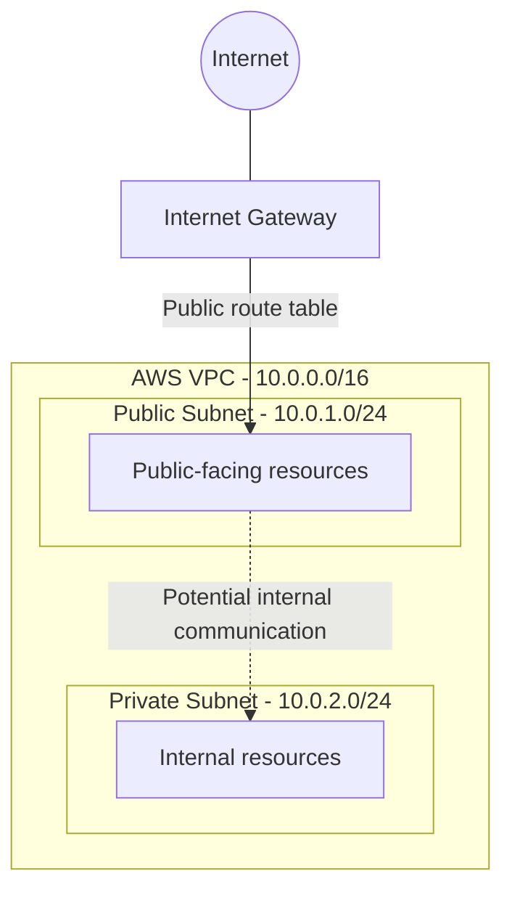

# AWS Network Infrastructure Using Terraform

## Project Overview
This project demonstrates how to deploy AWS networking
infrastructure using Terraform (Infrastructure as Code).

## Architecture
- AWS VPC: 10.0.0.0/16
- Public Subnet: 10.0.1.0/24
- Private Subnet: 10.0.2.0/24
- Internet Gateway
- Public Route Table
- Public Subnet Route Table Association

## Security Design
- Separates public and private network resources.
- Public subnet has a route to the Internet Gateway.
- Private subnet uses the main route table without
  a direct internet route.

## Technologies Used
- AWS
- Terraform
- AWS CLI
- Linux
## Network Architecture


## Deployment Instructions

### Prerequisites
- AWS account
- Terraform installed
- AWS CLI configured with appropriate permissions

### Deploy Infrastructure

1. Initialize Terraform:
   ```bash
   terraform init
   ```

2. Format and validate:
   ```bash
   terraform fmt
   terraform validate
   ```

3. Review the deployment plan:
   ```bash
   terraform plan
   ```

4. Deploy:
   ```bash
   terraform apply
   ```

5. Verify managed resources:
   ```bash
   terraform state list
   ```

## Cleanup

To remove the infrastructure managed by this Terraform project:

```bash
terraform plan -destroy
terraform destroy
```

Review the destruction plan before confirming.

## Security Considerations

- Public and private subnets are separated.
- The public subnet has a route to an Internet Gateway.
- The private subnet has no direct internet route.
- No NAT Gateway is deployed.
- No application servers or databases are deployed.
- AWS credentials and Terraform state files must not be committed to GitHub.
